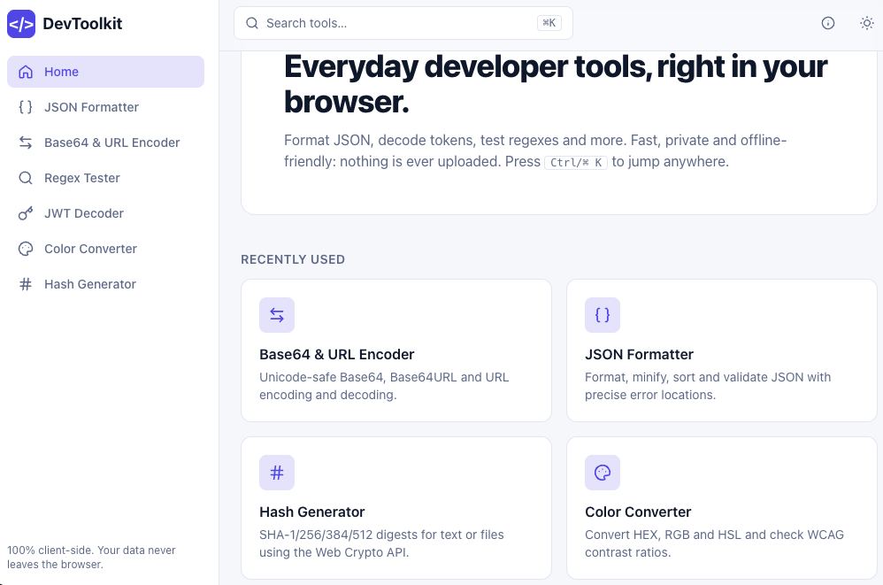
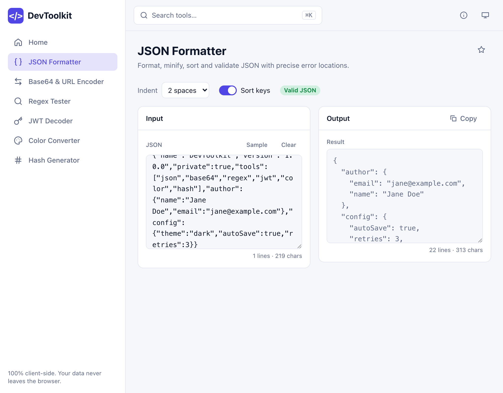
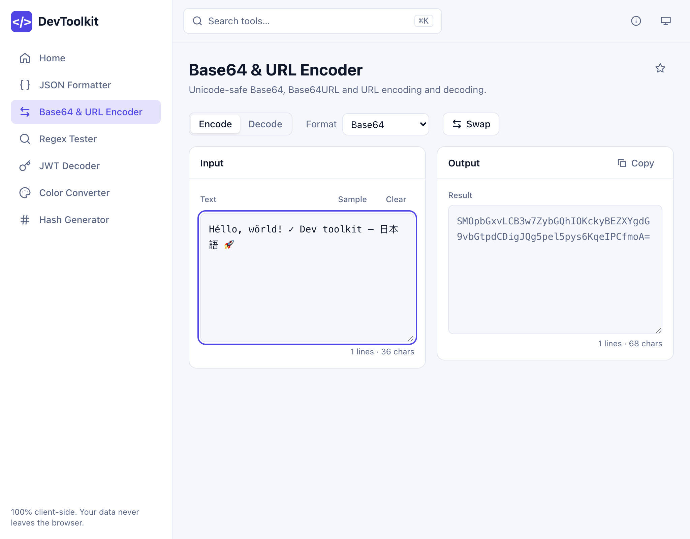
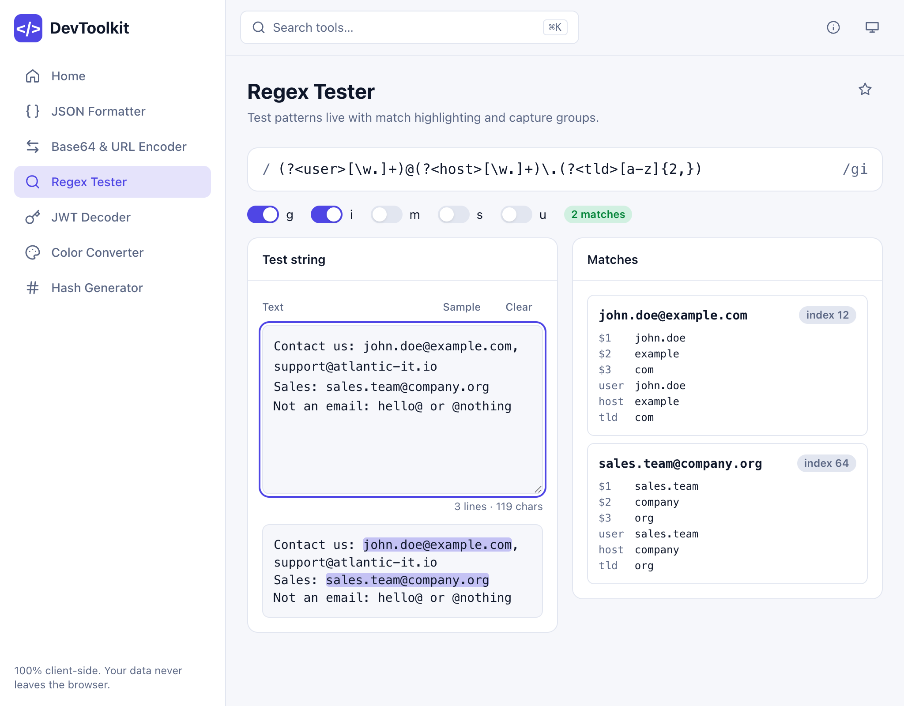
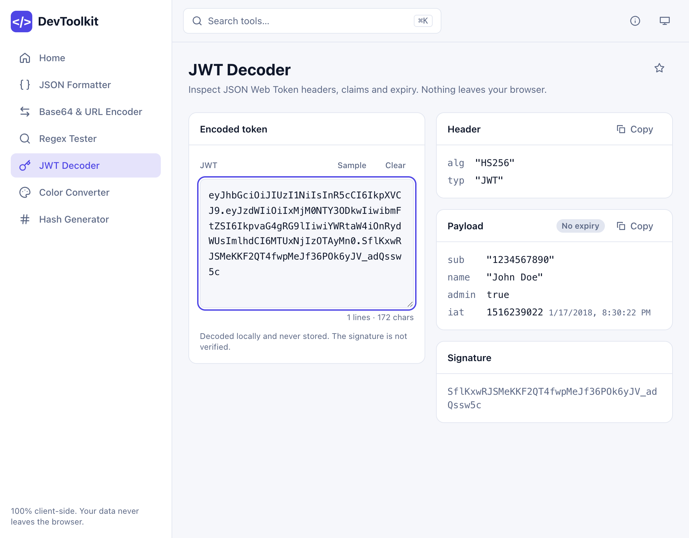
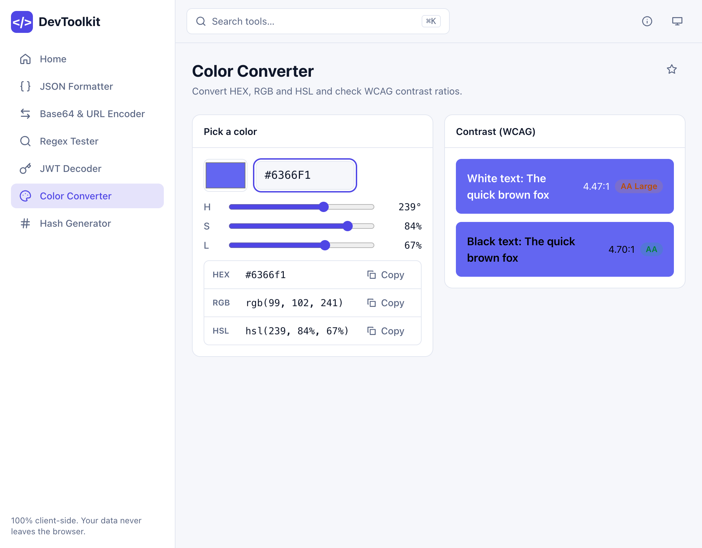
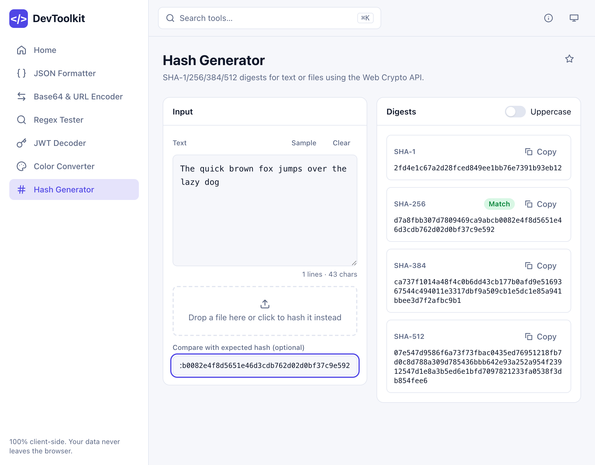

# DevToolkit

Everyday developer utilities that run **100% in your browser** — no backend, no database, nothing uploaded.

| Tool | Highlights |
| --- | --- |
| JSON Formatter | format / minify / sort keys, error line + column |
| Base64 & URL Encoder | Unicode-safe Base64, Base64URL, percent-encoding, one-click swap |
| Regex Tester | live highlighting, flag switches, numbered + named groups |
| JWT Decoder | header / claims / expiry status (token never persisted) |
| Color Converter | HEX ⇄ RGB ⇄ HSL, sliders, WCAG contrast |
| Hash Generator | SHA-1/256/384/512 for text or files (Web Crypto), compare-to-expected |

Also: command palette (`Ctrl/⌘ K`), favorites + recents, light/dark/system theme, responsive layout, per-tool persisted state.

## Screenshots

### Home

The landing page lists every tool as a card, with a **Recently used** section for quick access and a search box (`Ctrl/⌘ K`) to jump to any tool. The sidebar is generated from the same tool registry, so it always stays in sync.



### JSON Formatter

Paste minified JSON and get a pretty-printed result instantly. Choose the indent size, toggle **Sort keys** to alphabetize every object, and see a validity badge (or the exact line and column of a syntax error).



### Base64 & URL Encoder

Encode or decode text as Base64, Base64URL or percent-encoded URL text. It is Unicode-safe, so accents, CJK characters and emoji round-trip correctly, and **Swap** moves the output back into the input.



### Regex Tester

Type a pattern, toggle flags (`g`, `i`, `m`, `s`, `u`) and see matches highlighted live in the test string. Each match lists its index plus numbered and named capture groups.



### JWT Decoder

Paste a JSON Web Token to inspect its header, claims and signature. Timestamp claims such as `iat` and `exp` are shown as readable dates, with an expiry status badge. Decoding happens locally and the token is never stored.



### Color Converter

Enter a HEX value or use the picker and HSL sliders to get matching HEX, RGB and HSL values with one-click copy. The WCAG panel shows contrast ratios against white and black text, with AA/AAA ratings.



### Hash Generator

Generate SHA-1, SHA-256, SHA-384 and SHA-512 digests for text or a dropped file using the Web Crypto API. Paste an expected hash to get a **Match** badge, and switch the output to uppercase if needed.



## Stack

React 19 · TypeScript (strict) · Vite · Tailwind CSS v4 · Zustand · React Router · Vitest + Testing Library

## Design notes

- **Registry-driven** — [`src/tools/registry.ts`](src/tools/registry.ts) is the single source of truth. The sidebar, home grid, routes and command palette are generated from it, and each tool is a lazy-loaded chunk. Adding a tool = one component + one registry entry.
- **Pure logic in `src/lib`** — all tool logic is framework-free, returns a `Result<T>` instead of throwing, and is unit tested.
- **Small reusable UI kit** (`src/components/ui`): generic `Tabs`/`Select` (typed by option keys), `Switch`, `Slider`, `Modal` (native `<dialog>`), `Tooltip`, `Toaster`, `ErrorBoundary`, `TextArea`, `Panel`, …
- **React 19 features** — `use()` + Suspense (hash tool), `useDeferredValue` for responsive typing, `ref` as a prop, native `<dialog>` modal.
- **State** — Zustand stores (`persist` middleware) for app settings and per-tool input via `useToolState`.
- **Accessibility** — labelled controls, `role="tablist"/"switch"/"combobox"/"alert"`, keyboard navigation, visible focus rings.

## Scripts

```bash
npm install
npm run dev        # local dev server
npm test           # unit + component tests
npm run lint       # oxlint
npm run build      # type-check + production build to dist/
npm run preview    # serve the production build
```

## Deploy to Cloudflare Pages

Connect the repo in the Cloudflare dashboard (Workers & Pages → Create → Pages) and use:

- **Build command:** `npm run build`
- **Build output directory:** `dist`

Or deploy directly: `npm run build && npx wrangler pages deploy dist`.
`public/_redirects` provides SPA fallback so deep links like `/tools/jwt` work on refresh.
